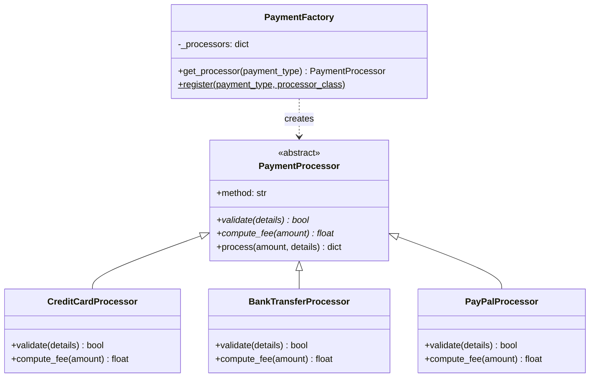
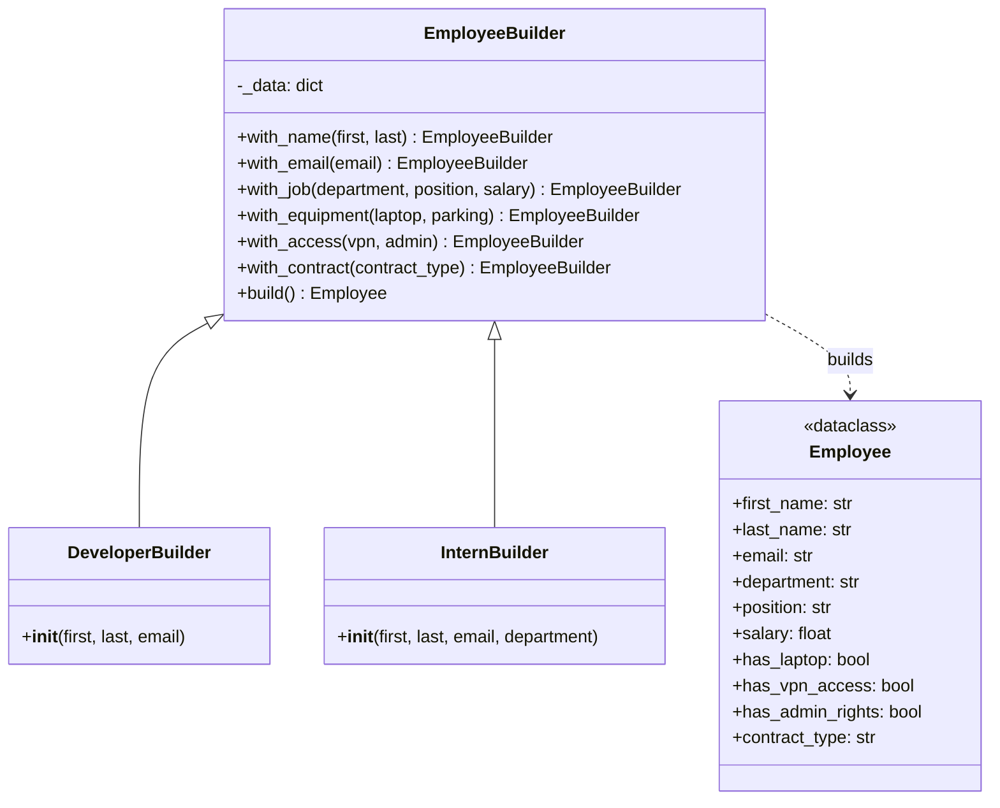
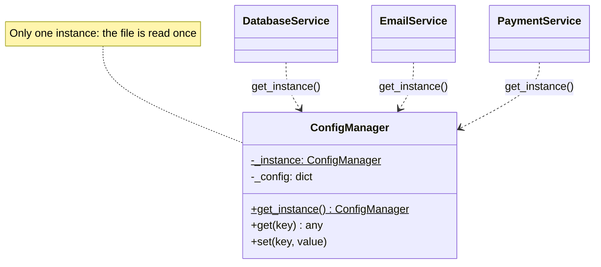
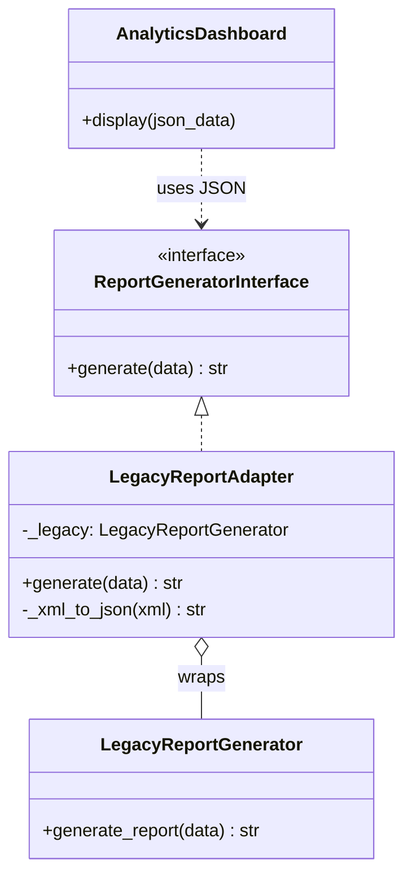
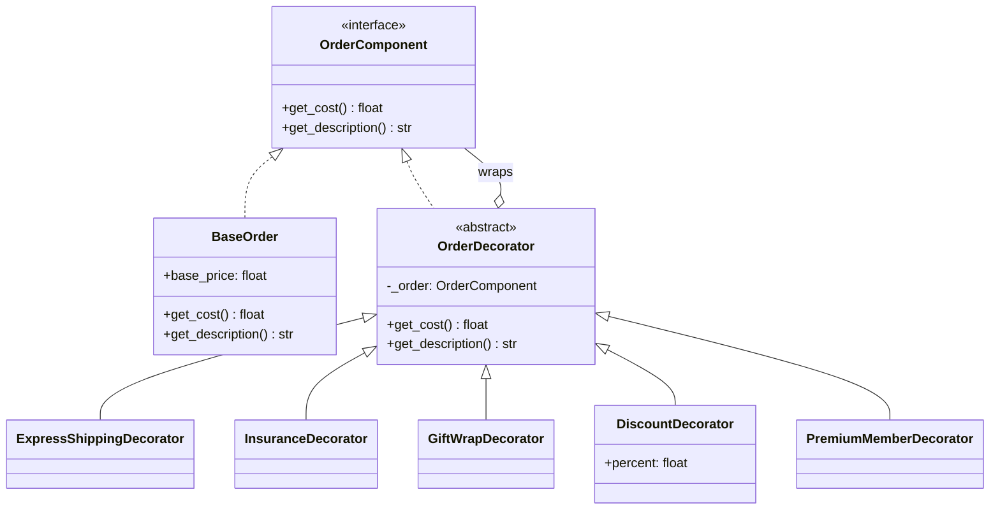
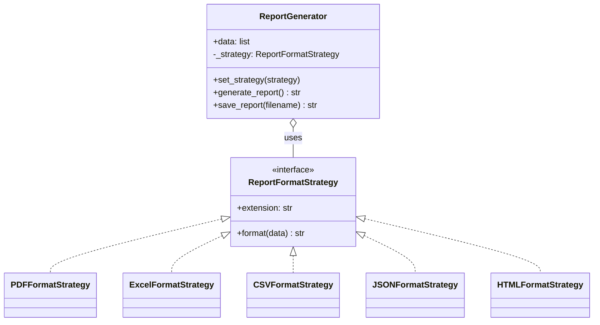
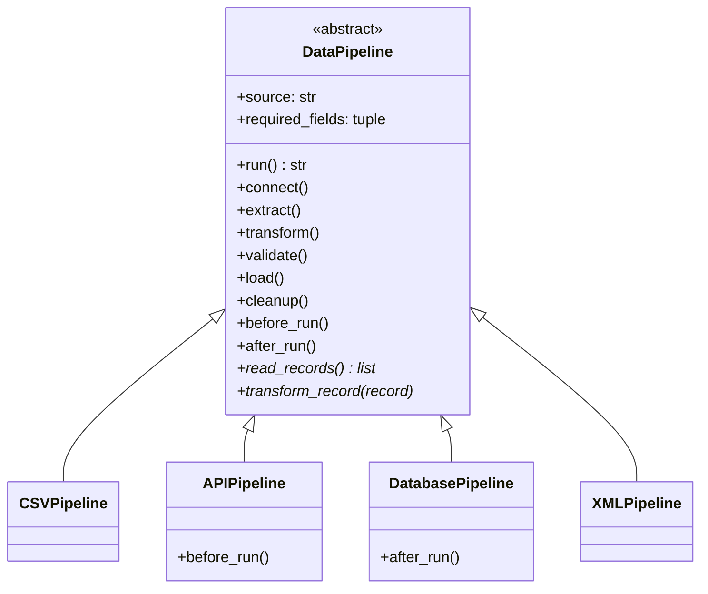

# UML class diagrams

## 1. Factory – Payment system

## 2. Builder – HR Employee onboarding

## 3. Singleton – Configuration manager

## 4. Adapter – Reporting system

## 5. Decorator – Order pricing

## 6. Strategy – Report formats

## 7. Template Method – ETL pipeline

